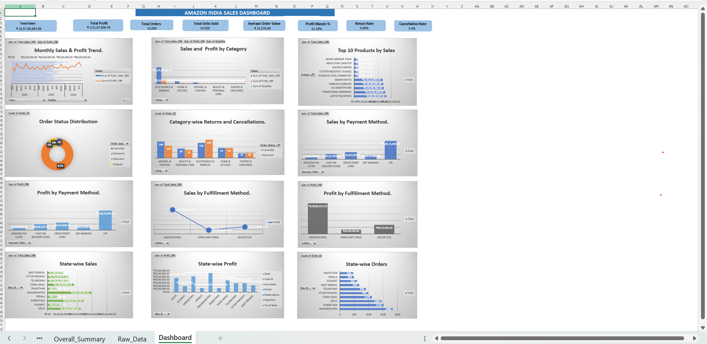

# **Amazon-India-Sales-Dashboard**

Amazon India Sales Analysis and Interactive Dashboard using Microsoft Excel.

&#x20;

#### **Project Overview**

This project presents an interactive sales analysis dashboard for Amazon India, developed using Microsoft Excel. It provides insights into sales performance, profitability, product categories, customer orders, payment methods, fulfilment methods, and geographical performance.

#### 

#### **Objectives**

\- Analyze overall sales and profit performance.

\- Identify top-performing product categories.

\- Evaluate payment and fulfilment methods.

\- Monitor order status, returns, and cancellations.

\- Identify high-performing states and markets.

\- Support data-driven business decisions.

#### **Tools and Technologies**

\- Microsoft Excel

\- Pivot Tables

\- Pivot Charts

\- Excel Formulas

\- Data Cleaning and Data Analysis

\- Interactive Dashboard Design

#### **Key Performance Indicators (KPIs)**

\- Total Sales: ₹155.79 Million

\- Total Profit: ₹33.17 Million

\- Total Orders: 10,000

\- Total Units Sold: 24,926

\- Average Order Value: ₹15,578.99

\- Profit Margin: 21.29%

\- Return Rate: 4.85%

\- Cancellation Rate: 5%

#### **Key Findings**

\- Electronics \& Mobiles is the leading product category.

\- UPI is the strongest payment method.

\- Amazon FBA is the dominant fulfilment method.

\- Maharashtra leads in both sales and profit.

\- Order returns and cancellations provide opportunities for operational improvement.

#### **Business Insights**

The analysis highlights strong sales performance and profitability. The dashboard helps identify business strengths, monitor operational efficiency, and discover opportunities to improve customer satisfaction and revenue growth.

#### **Conclusion**

This project demonstrates the use of Microsoft Excel for business intelligence and data analysis. It transforms raw sales data into meaningful insights through KPIs, pivot tables, charts, and an interactive dashboard.

## Dashboard Preview

